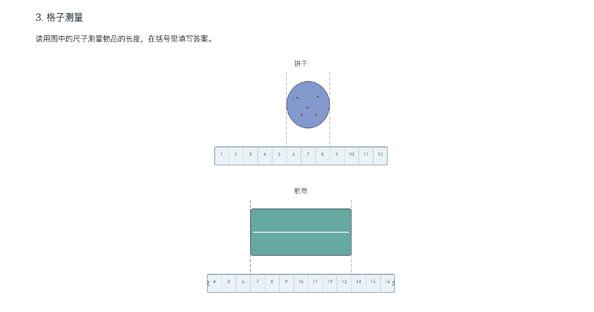
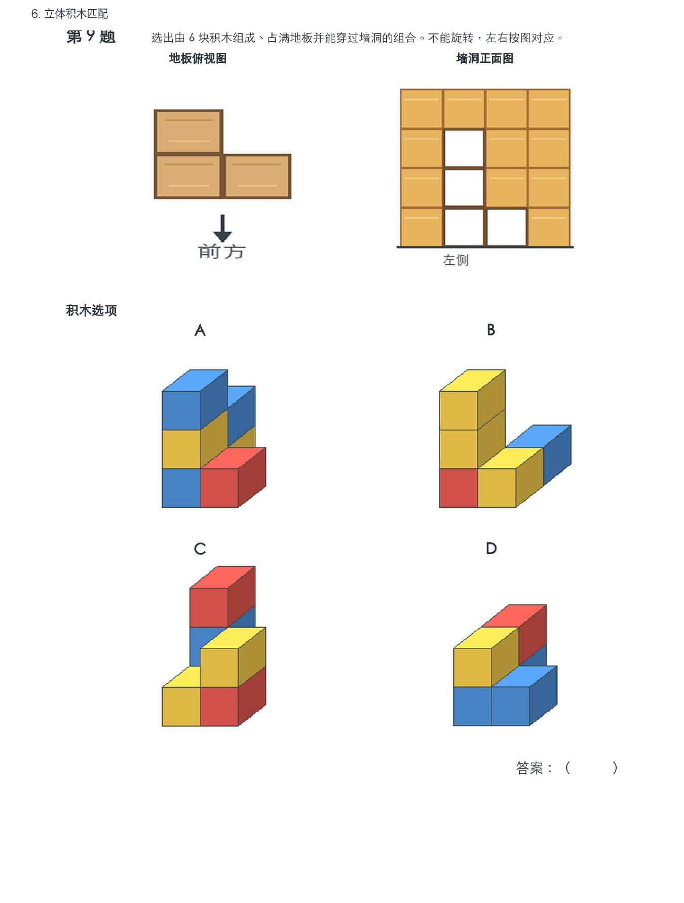
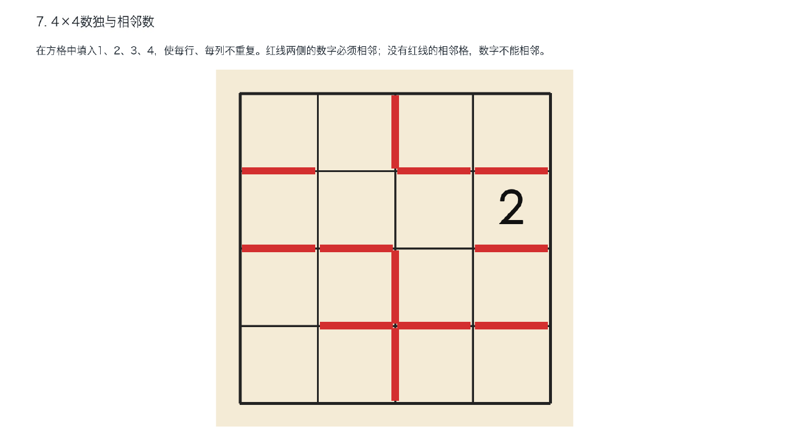
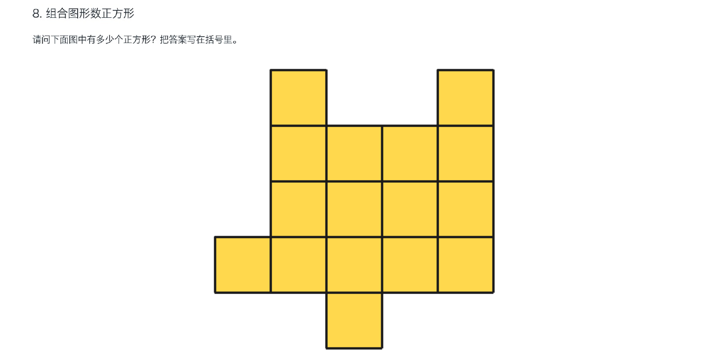
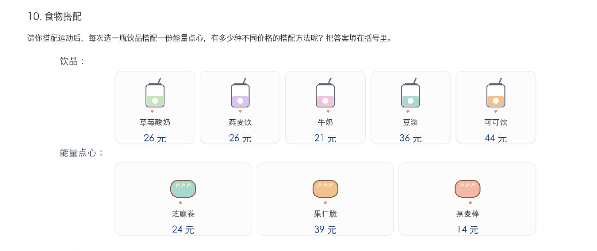
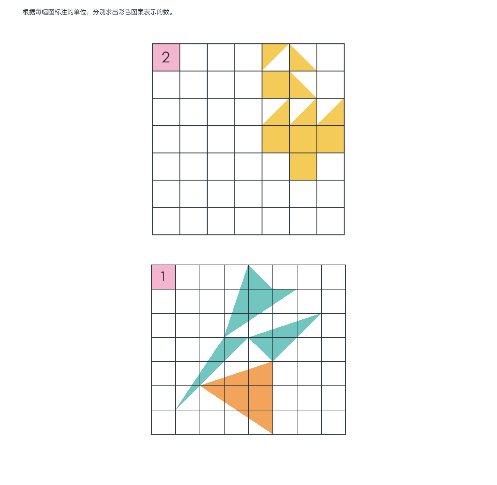

# 大班数学模拟题项目

本项目以学而思大班数学真题为参照，梳理题型和能力要求；再为部分题型编写生成逻辑与图形素材，产出 Word 练习，最后从已生成的题目中抽题，组合成多套模拟卷。

## 项目流程

```text
学而思真题 PDF
      ↓ 阅读题目、拆解考点与出题约束
题型提纲 outline.md
      ↓ 选取适合自动化的题型，编写任务书和运行说明
docs/ + src/
      ↓ 生成题目、配图和答案素材
generated/ 练习 Word 与图片素材
      ↓ 从题库抽题并组合
generated/大班数学综合模拟卷（三套）.docx
```

### 1. 从真题整理题型提纲

源材料是 [学而思《大班 S 嘉年华模拟卷 1》](docs/大班S嘉年华模拟卷1.pdf)。按照原卷 1–12 题逐题记录题型、核心考点、出题条件和可调整难度，形成 [题型提纲](outline.md)。提纲既用于复习，也作为后续题目设计的依据。

### 2. 把选定题型转成规则和代码

并非所有题型都直接自动生成。对适合程序化的题型，先在 `docs/` 写任务书或运行说明，明确题面要求、随机范围、唯一解或干扰项等约束，再在 `src/` 实现生成逻辑、配图和 Word 输出。程序化题型包括格子测量、立体积木匹配、4×4 数独、数正方形、食物搭配、方格面积等。

### 3. 生成练习并组卷

题目文档和配图保存在 `generated/`。目前各题型练习文档通常包含 12 道练习；已生成的题目再抽选组合成三套综合模拟卷，见 [大班数学综合模拟卷（三套）](generated/大班数学综合模拟卷（三套）.docx)。模拟卷中的题号按卷面顺序编排；下方示例使用原真题题号，便于和提纲对应。

## 真题题型示例

项目已编写生成代码的题型示例为原卷第 3、6、8、9、11、12 题。以下直接嵌入完整题面示例，包含题目文字、题图和作答位置。题图取自三套综合模拟卷的第一套；括号内标出该题在模拟卷中的卷内题号。

### 第 3 题：格子测量

请用图中的尺子测量物品的长度，在括号里填写答案。



饼干：（　　　　）格　　肥皂：（　　　　）格

练习文档：[格子测量练习 Word](generated/大班数学格子测量练习.docx)

### 第 6 题：立体积木匹配

选出由 6 块积木组成、占满地板并能穿过墙洞的组合。不能旋转，左右按图对应。（综合模拟卷第 6 题）



练习文档：[立体积木匹配练习 Word](generated/大班数学立体积木匹配练习.docx)

### 第 8 题：4×4 数独与相邻数

在方格中填入 1、2、3、4，使每行、每列不重复。红线两侧的数字必须相邻；没有红线的相邻格，数字不能相邻。（综合模拟卷第 7 题）



练习文档：[数独练习 Word](generated/大班数学4×4数独与相邻数练习.docx)

### 第 9 题：组合图形数正方形

请问下面图中有多少个正方形？把答案写在括号里。（综合模拟卷第 8 题）



练习文档：[数正方形练习 Word](generated/大班数学组合图形数正方形练习.docx)

### 第 11 题：食物搭配与不同总价

请你搭配运动后饮品和能量点心：每次选一瓶饮品搭配一份能量点心，有多少种不同价格的搭配方法？把答案填在括号里。（综合模拟卷第 10 题）



答案：（　　　　）种

练习文档：[食物搭配练习 Word](generated/大班数学食物搭配练习.docx)

### 第 12 题：方格面积与单位换算

根据每幅图标注的单位，分别求出彩色图案表示的数。（综合模拟卷第 11 题）



图 1 表示：（　　　　）　　图 2 表示：（　　　　）

练习文档：[方格面积练习 Word](generated/大班数学方格面积与单位换算练习.docx)

## 目录说明

- `docs/`：真题来源、题型任务书和生成器运行说明。
- `src/`：题目生成、题目逻辑、图形绘制及 Word 生成代码。
- `generated/`：练习 Word、综合模拟卷和配套图片素材。
- `outline.md`：按原卷题号整理的题型与考点提纲。

## 当前范围

自动化优先覆盖规则清晰、便于程序校验的题型。真题提纲中仍有题型尚未实现生成器；其中第 7 题目前保留了题型分析，还没有对应生成题或进入三套模拟卷。后续可按 `outline.md` 和 `docs/` 中的任务书继续扩展。
